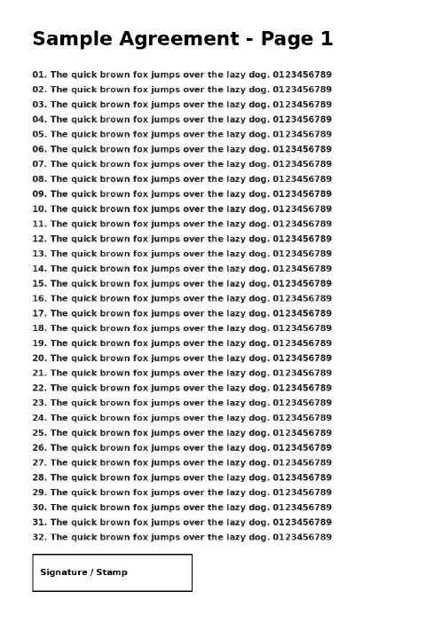
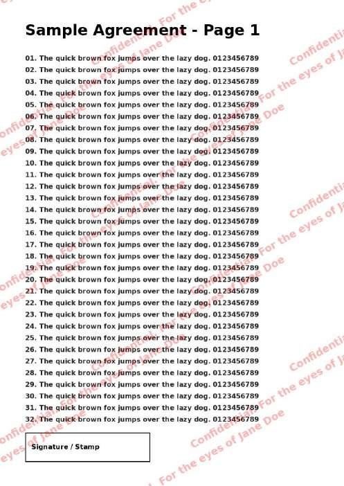
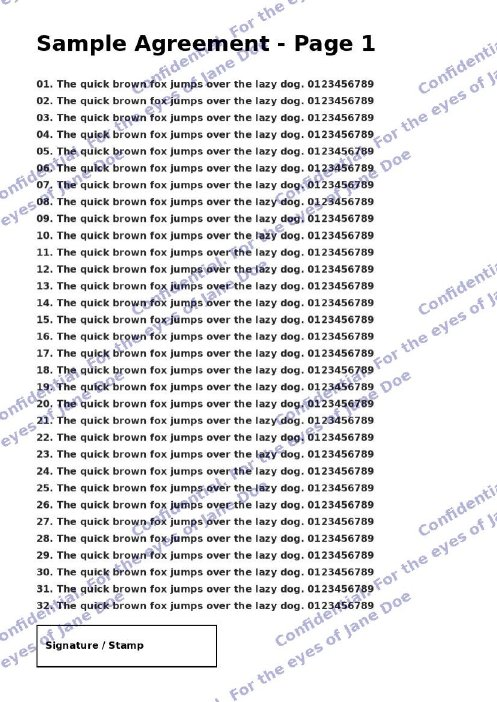
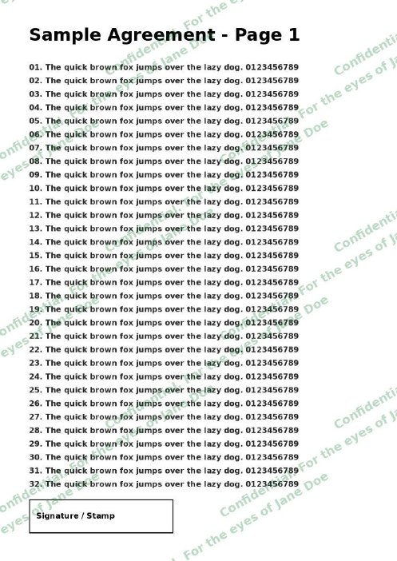
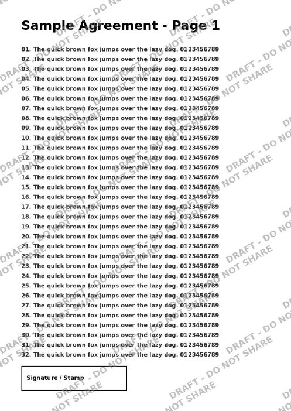

# pdf-watermark

Burn a text watermark into one or more PDFs so it can't be removed.

Each page is rendered to an image, the text is tiled diagonally across it and
the page is saved back as an image. There's no separate watermark layer or
text object for a PDF editor to delete.

Trade-offs: the output has no selectable or searchable text, and files are
usually larger than the originals.

## Requirements

- Python 3.8+
- [Pillow](https://pypi.org/project/Pillow/)
- `pdftoppm` from poppler (`apt install poppler-utils` / `brew install poppler`)

## Install

```sh
pip install .
```

Or run it without installing, from the repo root:

```sh
python3 -m pdf_watermark ...
```

## Usage

```sh
pdf-watermark deed.pdf permit.pdf -t "Confidential. For the eyes of Jane Doe"
pdf-watermark *.pdf -t "DRAFT" -c gray -o out/
pdf-watermark scan.pdf -t "COPY" -c "#0050c8" --opacity 0.5
```

| Option | Default | Description |
| --- | --- | --- |
| `FILE ...` | | One or more PDF files |
| `-t, --text` | (required) | Watermark text |
| `-c, --color` | `red` | Color name or hex code |
| `-o, --output-dir` | `./watermarked` | Where to write the output. Files keep their names |
| `--opacity` | `0.3` | Watermark opacity, 0 to 1 |
| `--dpi` | `200` | Render resolution. Higher is sharper but makes bigger files |
| `--font` | DejaVu Sans Bold or similar | TrueType font for the text. Needed for non-Latin text, e.g. a Bengali font for Bengali text |

The tool won't overwrite an input file. It exits with `1` if any file fails
and keeps going with the rest.

## Tests

```sh
python3 -m unittest -v
```

## Examples

Page 1 of [a sample document](examples/sample.pdf) with a few settings.
Click a name to open the full PDF.

| [Original](examples/sample.pdf) | [Red (default)](examples/output/red.pdf) | [Navy](examples/output/navy.pdf) |
| --- | --- | --- |
|  |  |  |
| | `-t "Confidential. For the eyes of Jane Doe"` | `... -c navy` |

| [Green](examples/output/green.pdf) | [Gray draft](examples/output/gray-draft.pdf) |
| --- | --- |
|  |  |
| `... -c "#1a7f37"` | `-t "DRAFT - DO NOT SHARE" -c gray --opacity 0.5` |

The example PDFs are rendered at `--dpi 100` to keep the repo small. To
rebuild them, run `python3 -m examples.build` from the repo root.
